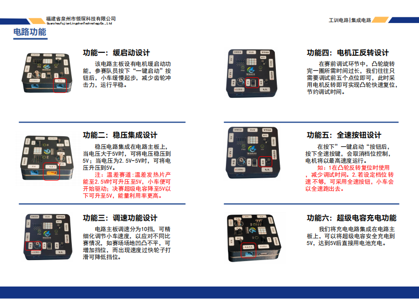
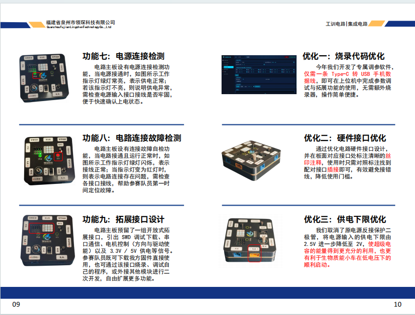
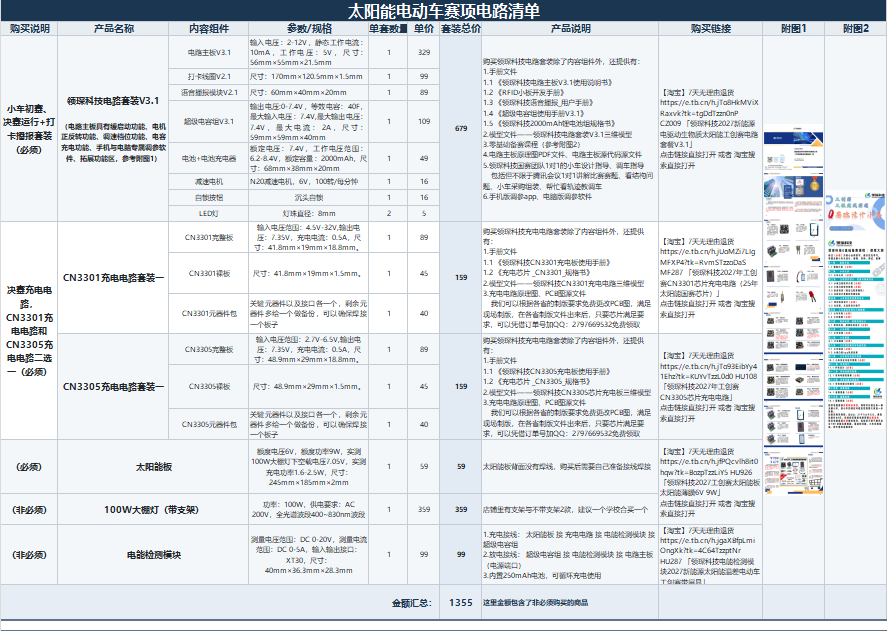
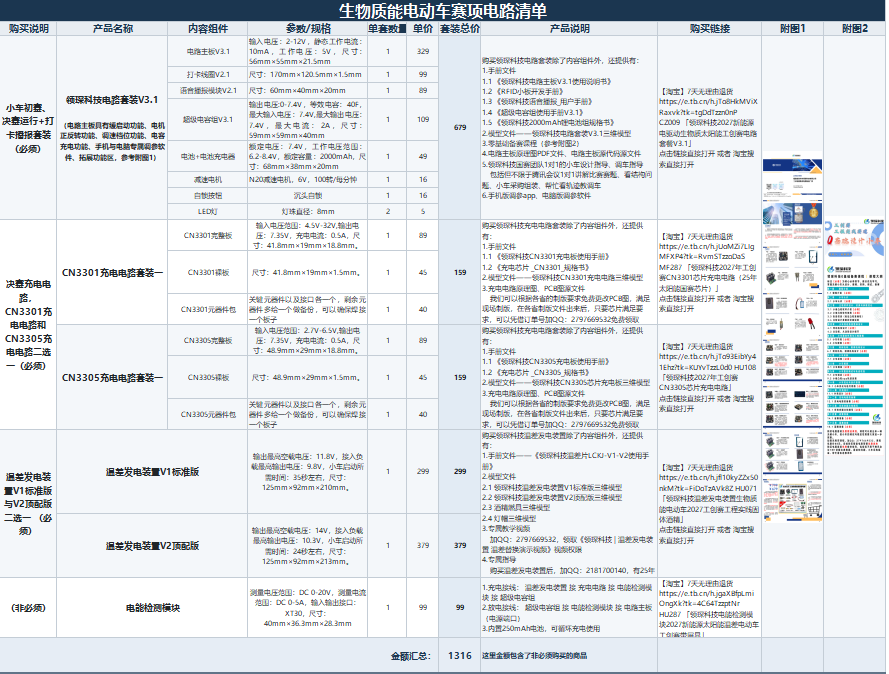

# 领琛科技工创赛工程实践赛道的公开工程

领琛科技工创赛工程实践赛道的公开工程。以 NuttX 为基础平台搭建，是当前默认的公开版本。工程包含板级配置、主控逻辑、RFID 和语音播报。我们自己的程序在 `apps/myprojects/`，可执行代码与当前版本一致。

主体逻辑、RFID 和语音播报：

- 主体逻辑：`apps/myprojects/projects/project1/project1_main.c`
- RFID：`apps/myprojects/modules/rfid/`
- 语音播报：`apps/myprojects/modules/vtx/`

`project1_main.c` 开头有导读。

板上的配置目录：`nuttx/boards/arm/stm32/stm32f103-minimum/configs/project1/`

电脑端命令格式：`apps/myprojects/projects/project1/CDC_JSON_PROTOCOL.md`

## 电路功能

## 赛项电路清单

### 太阳能电动车赛项电路清单

### 生物质能电动车赛项电路清单

